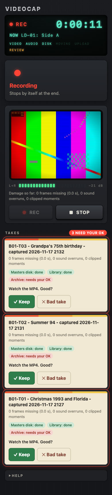

# Videocap

> **0.0.1 alpha.** Runs end to end in its tests and demo, but hasn't yet recorded a real tape on real hardware.
> Keep your tapes until you've checked the masters.

**Unattended capture from analog video.** Plug a VCR, camcorder, LaserDisc player or any composite or S-Video
source into a USB capture stick on a Raspberry Pi or other Linux machine, press play, and walk away. Each capture
becomes a lossless master and an MP4, named from your list, with a report of anything the capture lost.

- **Lossless master** (FFV1 + PCM in Matroska) and an **MP4 for watching** (H.264, deinterlaced, cropped).
- **Hands-off:** it's already recording when you press play, and stops by itself when the source ends.
- **Damage report** for each capture: dropped frames, sound overruns, clipping, a silent channel.
- **Name as you go,** or paste your list from a spreadsheet: titles, dates and notes go into your media library.
- **Review before archive:** masters wait for your OK on the web page.
- **Goes where you choose:** the disk you plugged in, or a NAS, AWS, a VPS, Dropbox and anything else rclone reaches.

NTSC and PAL, standard definition: VHS, Hi8, Betamax, LaserDisc, analog cameras and more.



## What you need

- A **Raspberry Pi 5** (4 GB) or any Linux machine
- A **USB capture stick** (see [docs/profiles.md](https://github.com/aidansiegel/videocap/blob/main/docs/profiles.md))
- A **USB disk** for captures

About $225 before the disk: a Pi 5 4 GB ($110), its 27 W power supply ($12), a case with a fan ($20) and a microSD card
($25) at Micro Center in November 2026, plus a Hauppauge USB-Live2 (about $55).

## Install

On Raspberry Pi OS, Debian or Ubuntu:

```bash
git clone https://github.com/aidansiegel/videocap.git && cd videocap
sudo ./install.sh
sudo nano /etc/videocap/videocap.conf
```

Then open **http://videocap.local/** on a phone or computer on the same network.

To try it without hardware, run `./demo.sh` on Linux or a Mac (needs ffmpeg and rclone).

## More

- [Guide](https://github.com/aidansiegel/videocap/blob/main/docs/guide.md): day to day, settings, live sources, widescreen, what it writes
- [Destinations](https://github.com/aidansiegel/videocap/blob/main/docs/recipes.md): NAS, AWS, VPS, Dropbox
- [Capture sticks](https://github.com/aidansiegel/videocap/blob/main/docs/profiles.md): profiles, and measuring your own

## License

GPL-3.0-or-later. See [LICENSE](https://github.com/aidansiegel/videocap/blob/main/LICENSE).
